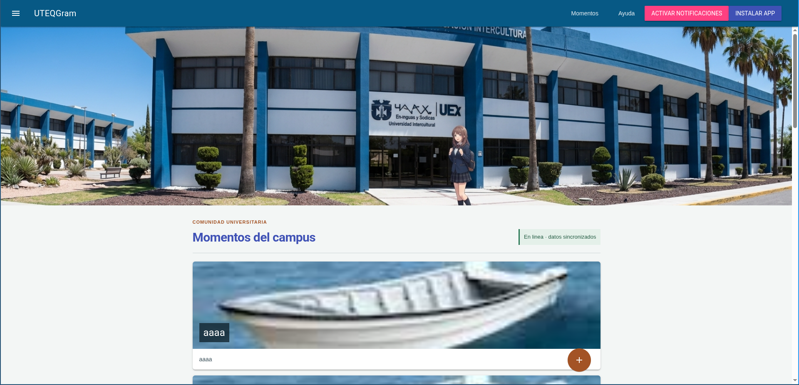
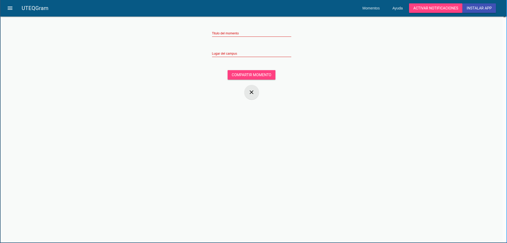
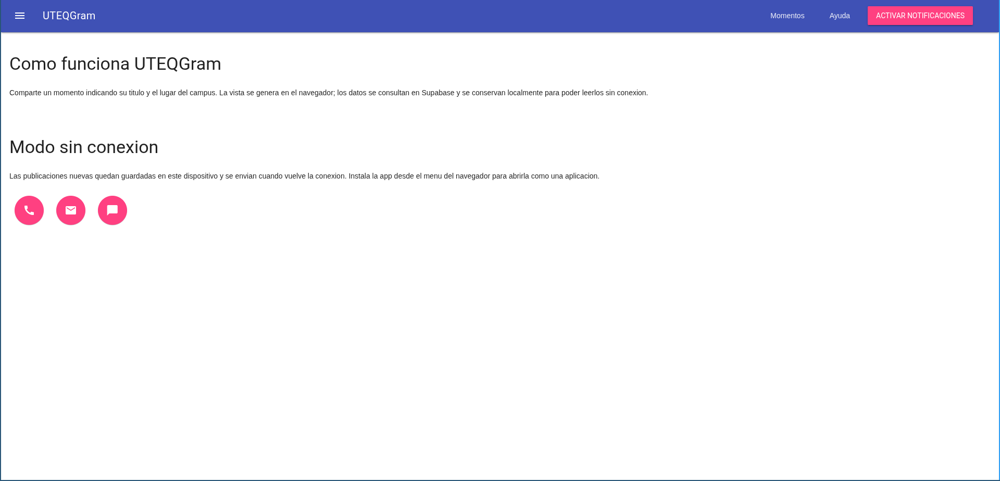
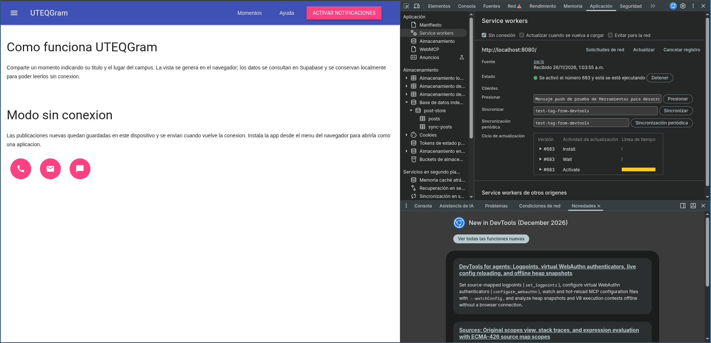
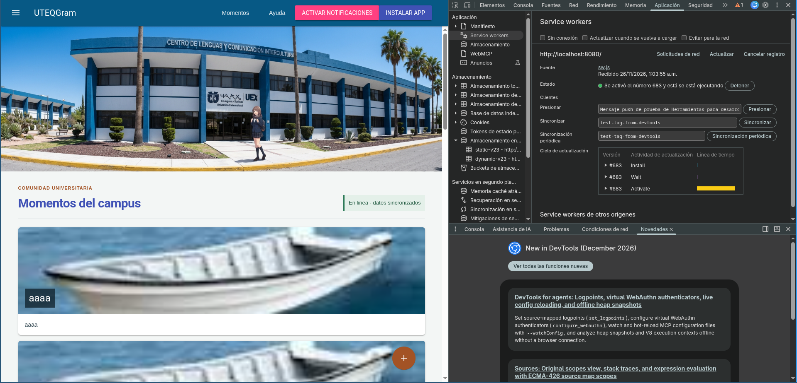
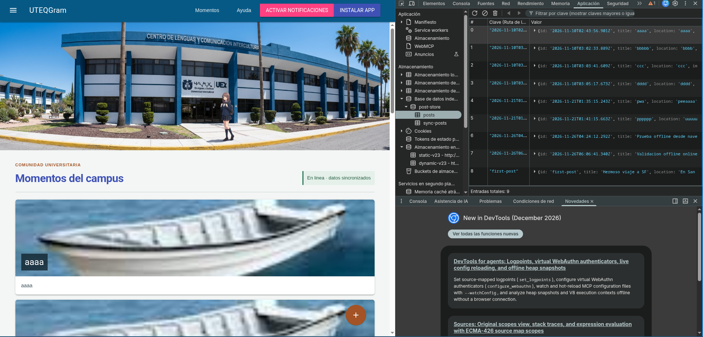

# Caso de estudio: UTEQGram, comunidad del campus

**Nombre:** Bruno Lopez de la Cruz  
**Institución:** UTEQ  
**Profesor:** José Alberto Delgadillo Gutierrez

## 1. Resumen

UTEQGram es una aplicación web progresiva para compartir momentos breves de la comunidad universitaria. El caso de uso es registrar una actividad o sitio del campus mediante un título y una ubicación, consultar publicaciones existentes y seguir usando el feed cuando no hay conexión. La página principal y la pantalla de ayuda se generan en el cliente con HTML, CSS y JavaScript; no hay renderizado de servidor para la interfaz.

## 2. Plataformas y herramientas

| Plataforma o herramienta | Uso en el caso | Justificación |
| --- | --- | --- |
| HTML, CSS y JavaScript | Interfaz adaptable, feed, formulario y navegación | La app es ligera, estática y no requiere un framework ni compilación para entregar sus vistas. |
| Material Design Lite 1.3 | Componentes de navegación, botones, campos y snackbar | Se conserva la base visual existente y se complementa con CSS propio para el contexto universitario. |
| Service Worker y Cache API | Precache del shell; respuesta local para rutas y recursos; fallback offline | Permiten abrir la app y su pantalla de ayuda sin conexión después de la primera visita. |
| IndexedDB | Copia local de publicaciones y cola de elementos pendientes | Guarda datos estructurados de forma persistente en el navegador; hace posible consultar y redactar offline. |
| Supabase REST/PostgREST | Fuente remota compartida para las publicaciones | Proporciona persistencia compartida entre dispositivos sin construir un servidor propio para este prototipo. |
| Background Sync | Envío diferido de la cola cuando el navegador lo soporta | Mejora la sincronización en navegadores compatibles; el guardado local no depende de esta API. |
| Node.js, npm y `http-server` | Servidor de desarrollo y pruebas automatizadas | Reutiliza las dependencias del repositorio y permite servir `public/` por HTTP, requisito para Service Worker e IndexedDB. |
| Vercel | Publicación del sitio estático | El repositorio ya tiene una URL de producción asociada y `vercel.json` conserva configuración de rutas. |

## 3. Parámetros de configuración

### Aplicación web progresiva

- Documento de entrada: `public/index.html`; idioma español, viewport adaptable y metadatos de instalación.
- Manifiesto: `public/manifest.json`; `start_url: /`, `scope: /`, `display: standalone`, tema `#075985`, fondo `#f3f6f5` e iconos PNG de 192 y 512 px en `public/icons/`.
- Service Worker: `public/sw.js`, registrado en `/sw.js` con alcance raíz.
- Cachés versionadas: `static-v23` y `dynamic-v23`. La caché estática incluye la home, ayuda, fallback, scripts, estilos, imágenes e iconos. Al cambiar assets del shell se debe incrementar la versión.
- Estrategia: shell estático desde Cache API; GET de publicaciones consulta Supabase y cae a respuesta en caché cuando la red falla; los registros recuperados se guardan en IndexedDB.

### Datos locales y remotos

- IndexedDB: base `post-store`, versión `2`; almacenes `posts` y `sync-posts`, ambos con `id` como clave.
- Supabase: endpoint REST configurado en `public/src/js/feed.js` y `public/sw.js`; tabla/recurso `post`, lectura `?select=*`, escritura JSON con `Prefer: return=representation`.
- Campos de publicación: `id`, `title`, `location` e `image`. Las imágenes nuevas usan el recurso local `/src/images/main-image.jpg` para que no dependan del acceso a almacenamiento externo.
- Sin conexión: escribir primero en `posts` y `sync-posts`, renderizar de IndexedDB y solicitar Background Sync cuando el navegador lo permite. Al volver la conexión se intenta procesar la cola.
- Credencial de Supabase: se usa una clave pública/anon de cliente, no una clave `service_role`. En producción, las políticas RLS deben limitar lectura/escritura al nivel apropiado y no se deben incluir secretos administrativos en JavaScript público.

### Desarrollo y publicación

- Instalar dependencias: `npm install`.
- Ejecutar localmente: `npm start` (sirve la carpeta `public/` en el puerto 8080 por defecto).
- Ejecutar pruebas: `npm test`.
- Publicación configurada: `https://proyecto-del-curso.vercel.app/`.
- Repositorio de código fuente: `https://github.com/BrunoLopezDC/proyecto-del-curso`.
- Estado de publicación: La aplicación está publicada en Vercel y responde HTTP 200. Verificado el 26 de noviembre de 2026, el alias sirve `static-v23`, igual a la copia entregada.

## 4. Vistas y generación

1. **Home / Momentos:** `public/index.html`; HTML y componentes se cargan en el navegador. El feed combina publicaciones remotas y locales. El estado muestra si se está usando la red o el modo local.
2. **Crear momento:** formulario del cliente con título y lugar. La tarjeta aparece desde IndexedDB y se envía al backend cuando hay conectividad.
3. **Ayuda:** `public/help/index.html`; página estática cacheada con explicación del uso y del modo offline.
4. **Fallback offline:** `public/offline.html`; respuesta cacheada cuando se solicita una página HTML que no se puede recuperar de red ni de caché.

No hay vistas renderizadas del lado del servidor: Supabase entrega datos JSON, y el cliente produce las tarjetas del feed.

*Figura 1. Home y feed con conexión en línea.*

*Figura 2. Formulario de creación de un momento.*

*Figura 3. Página de ayuda de UTEQGram.*

## 5. Reporte de pruebas

Fecha de ejecución: 2026-11-26, entorno local Linux con Node.js/npm y Chrome. Las pruebas y capturas corresponden al entorno local (`localhost:8080`).

| Prueba | Resultado | Evidencia |
| --- | --- | --- |
| Validación de JSON del manifiesto | Aprobada | Parseo de `public/manifest.json`. |
| Iconos declarados en el manifiesto | Aprobada | Los archivos locales de 192 y 512 px existen. |
| Recursos locales del shell precacheado | Aprobada | Los recursos enumerados en `STATIC_FILES` existen en `public/`. |
| Sintaxis de app, feed y service worker | Aprobada | `node --check` sobre los tres scripts. |
| Persistencia offline independiente de Background Sync | Aprobada | Prueba automatizada verifica escrituras en `posts` y `sync-posts` y la comprobación condicional de la API. |
| Suite automatizada | **4 aprobadas, 0 fallidas** | `npm test` (`node --test`). |
| Renderizado y feed en navegador local | Aprobada | Servidor `npm start`; se comprobó la home, la imagen local y publicaciones remotas existentes. |
| Flujo offline→online | **Aprobada** | Se creó una publicación de prueba con la red desactivada, se verificó su guardado local, se reconectó, se encontró en Supabase con HTTP 200 y se confirmó que la cola `sync-posts` quedó vacía. La fila de prueba se eliminó después. |
| URL de Vercel | Aprobada | El alias responde HTTP 200 y su service worker es `static-v23`, igual a la copia entregada. |

*Figura 4. Feed local disponible sin conexión.*

*Figura 5. Cache Storage muestra las cachés `static-v23` y `dynamic-v23`.*

*Figura 6. IndexedDB muestra `post-store`, `posts` y `sync-posts`.*

